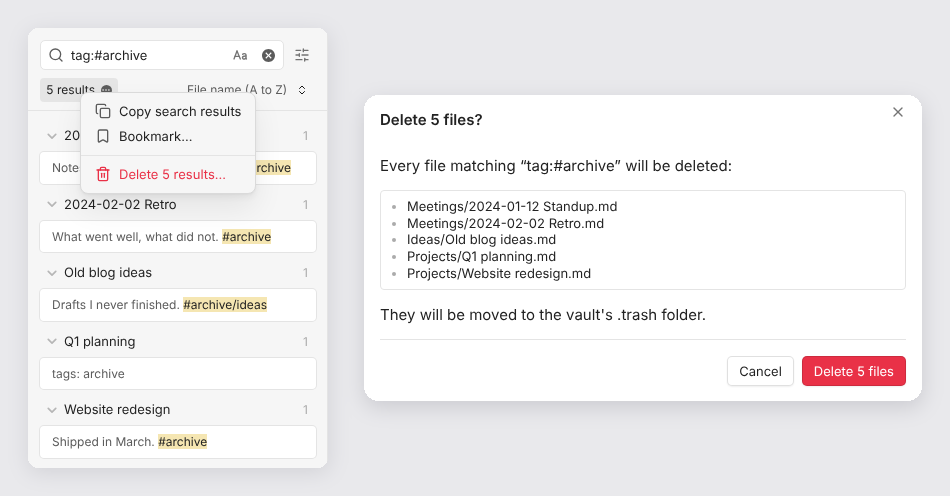

# Note Purge

Delete every note in the current search results at once, for example all notes
with a given tag.



## Usage

1. Search for the notes to delete, for example `tag:#archive`, or click a tag
   in the Tags view.
2. Click the result count (**5 results**) at the top of the search pane.
3. Choose **Delete 5 results…**.
4. Check the files listed in the dialog, then select **Delete 5 files**.

## Behavior

- Exactly the files listed in the dialog are deleted. A tag search also matches
  nested tags: `tag:#archive` includes notes tagged `#archive/ideas`.
- Files are deleted according to **Settings → Files and links → Deleted
  files**: moved to the system trash, moved to the vault's `.trash` folder, or
  deleted permanently. The dialog says which, in red when it's permanent.
- Attachments linked from the deleted notes are kept.
- The menu item is disabled while a search is still running, or when there are
  no results.
- Works on desktop and mobile, with Obsidian 1.6.6 or later.

Obsidian has no public API for the search results menu, so Note Purge uses the
internal `search:results-menu` event, the same one the core Bookmarks plugin
uses to add **Bookmark...**. If a future Obsidian version changes that event,
the Delete item stops appearing and nothing is deleted.

## Installation

In Obsidian, open **Settings → Community plugins → Browse**, search for
**Note Purge**, then select **Install** and **Enable**.

To install from GitHub instead, add `joelreymont/obsidian-note-purge` in
[BRAT](https://github.com/TfTHacker/obsidian42-brat), or copy `main.js`,
`manifest.json` and `styles.css` from the
[latest release](https://github.com/joelreymont/obsidian-note-purge/releases/latest)
into `<vault>/.obsidian/plugins/note-purge/`.

## Development

```bash
npm install
npm run build   # type-check, then bundle src/main.ts into main.js
```

To release, bump `version` in `manifest.json`, `package.json` and
`versions.json`, push to `main`, and run the **Release** workflow from the
Actions tab (or push a tag with the same version).

## License

[MIT](LICENSE)
